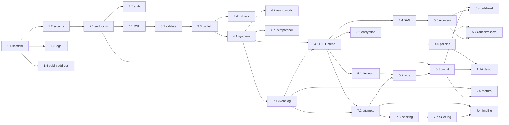
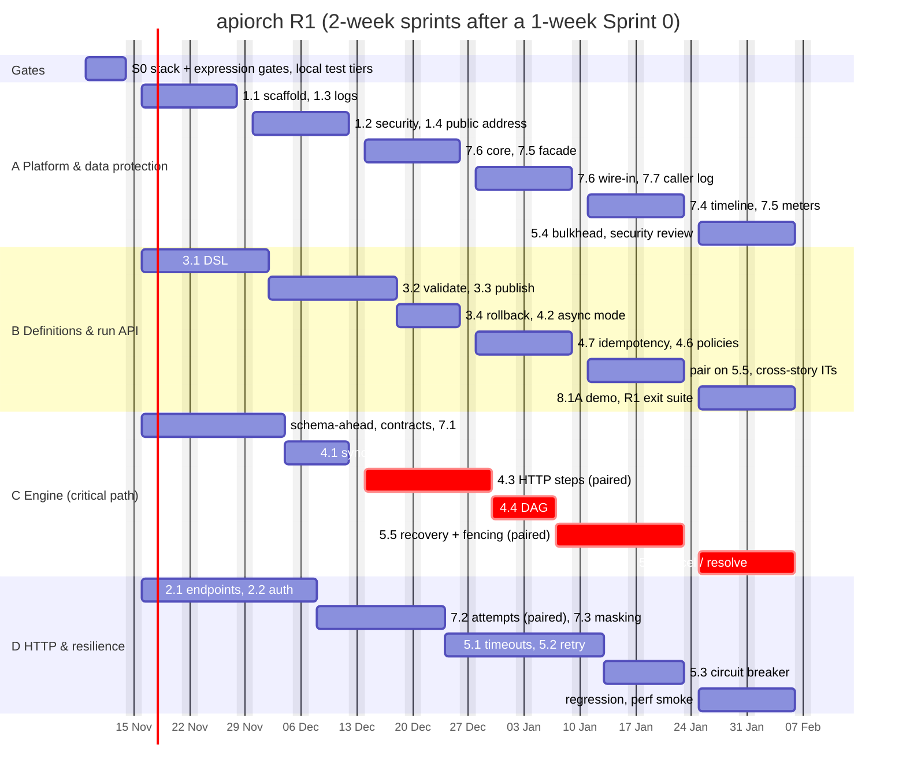

# apiorch — R1 Implementation Plan

**Release:** R1, the internal milestone (README §3). **Source of truth:**
[user-stories/README.md](../user-stories/README.md). Story IDs, sizes and dependencies below come
from its §2 story map. Where this plan overlaps work for speed, it says so explicitly.

---

## 1. Scope

R1 contains **30 items**: 29 stories and US-8.1 slice A.

| Epic | Stories (size) |
|---|---|
| E1 Foundation | US-1.1 (M), US-1.2 (M), US-1.3 (S), US-1.4 (S) |
| E2 Endpoints | US-2.1 (M), US-2.2 (M) |
| E3 Definitions | US-3.1 (L), US-3.2 (M), US-3.3 (M), US-3.4 (S) |
| E4 Run execution | US-4.1 (M), US-4.2 (S), US-4.3 (L), US-4.4 (M), US-4.6 (M), US-4.7 (S) |
| E5 Resilience | US-5.1 (M), US-5.2 (M), US-5.3 (M), US-5.4 (S), US-5.5 (L), US-5.7 (M) |
| E7 Logging & data protection | US-7.1 (M), US-7.2 (M), US-7.3 (M), US-7.4 (M), US-7.5 (M), US-7.6 (M), US-7.7 (M) |
| E8 Enablement | US-8.1 **slice A**, the sync reorder demo (≈ S) |

**Not in R1:** all of E6 (async steps, callbacks, caller webhooks), plus resume (US-5.8),
retention and partition maintenance (US-7.8), erasure (US-7.10), allowed callers (US-4.8),
promotion (US-3.6), disable (US-3.7), endpoint history (US-2.3), and everything in R3. Their DSL
fields are rejected at publish by the feature gate (US-3.2 AC7).

**R1 exit criteria** (README §3), verified in §9 below:
- sync and caller-async runs;
- sequence and DAG with mapping;
- retries, timeouts, circuit breakers and backpressure;
- crash recovery, plus cancel and resolve;
- the full activity log, including the caller exchange;
- metrics and encrypted working data;
- no-redeploy reorder and rollback;
- reachability on a stable public address;
- a runnable reorder demo.

## 2. Effort and assumptions

| Item | Value |
|---|---|
| Story effort (README sizes: S ≈ 2, M ≈ 4.5, L ≈ 8 dev-days midpoint) | **≈ 129 dev-days** (range 86–172) |
| Non-story work: Sprint 0 setup, local build tiers, environments, shared test harnesses, hardening | **≈ 20 dev-days** |
| **Total** | **≈ 150 dev-days** (range ≈ 105–200) |
| Team assumed | 4 backend developers, 1 QA/SDET (shared), part-time DevOps/DBA support |
| Cadence | 2-week sprints. Focus factor 0.7, so ≈ 7 productive dev-days per developer per sprint and **≈ 28 per sprint** for the team |
| Duration | **Sprint 0 (1 week) + 6 sprints (12 weeks) ≈ 13 weeks** |

**Re-estimate before Sprint 1.** These stories grew in the latest backlog edits, but their size
labels didn't change:

| Story | Added scope | Re-estimate |
|---|---|---|
| US-1.1 | ArchUnit rules with violating fixtures, three test tiers, `MigrationIT` with partition assertions, branch-coverage gate, the stack-compatibility gate | L |
| US-3.1 | `dslVersion`; the JSONata go/no-go gate with the restricted-evaluator fallback | L, or L+ if the gate fails |
| US-7.1 | Database grant model (append-only roles), monthly partitions plus helper function | M+ |
| US-7.4 | Partition pruning with `EXPLAIN` assertions, `PAYLOAD_ACCESSED` events | M+ |

The 20 dev-days of non-story work absorb part of this growth. If planning poker lands materially
higher, the plan stretches by about one sprint per extra 28 dev-days (§11).

## 3. Sprint 0: decisions and setup (1 week, whole team)

Sprint 0 exists because two decisions change code in every later story, and one dependency
lives outside the team.

| # | Item | Output | Owner | Why now |
|---|---|---|---|---|
| G1 | **Stack gate: done 2026-11-04, re-run for the owner's stack.** The first run (ADR-001, Boot 4.1.2 on PostgreSQL) is superseded. The product owner fixed **Spring Boot 3.5.14 + Spring Cloud 2025.0.3 on JDK 17, SQL Server in production and H2 (MSSQL mode) for dev and test**. Probe `tools/stack-probe-b35-mssql` passes 24/24 (15 on the H2 fast tier, plus 9 on Testcontainers SQL Server 2022). Findings F1–F16 cover: H2 ignores SQL Server lock hints; the `SYSUTCDATETIME()` shim; `SET LOCK_TIMEOUT` scoping; the `Instant` zone shift; no `JSON_VALUE` or filtered indexes on H2. They are applied to the stories | [ADR-003](adr/ADR-003-boot35-sqlserver.md), **Accepted 2026-11-05** | Tech lead | Boot 3.5's OSS support ended 2026-06-30 (owner-accepted; risk R1) **Update 2026-11-05:** acceptance pack in [`docs/sprint0/G-adr-acceptance.md`](sprint0/G-adr-acceptance.md), including the Boot 3.5 support decision. **Update 2026-11-05: ADR-003 accepted** at the Sprint 0 review, with the support path as recommended (decision 1) and SQL Server-only proofs nightly (decision 4). |
| G2 | **Expression engine gate: done 2026-11-04.** **Result: `GuardedJsonataEvaluator`** over JSONata 0.9.10 (US-3.1 row 2); the restricted fallback is not needed. Library bounds stopped 7 of 10 hostile cases. The other gaps are closed by guards: a `$pad` hang (capped built-in), deep nesting overflowing the parser (pre-compile limit), and wrapped exceptions (cause-chain mapping). Instances are pooled because they write shared fields. The budget is 1 s, because the wall-clock bound aborted healthy expressions at 100 ms and 250 ms under load | [ADR-002](adr/ADR-002-expression-engine.md), **Accepted 2026-11-05** | Definitions dev | Sprint 1 adds about 1–2 dev-days for the built-in audit (D3) **Update 2026-11-05:** acceptance pack in [`docs/sprint0/G-adr-acceptance.md`](sprint0/G-adr-acceptance.md), including the D6 regex sign-off for the Business Owner. **Update 2026-11-05: ADR-002 accepted**, D7 double arithmetic accepted, and **D6 regex ban signed off** by the Business Owner. |
| S1 | Git repository, trunk-based flow with short-lived branches merged into `main` locally after review, README §13 Definition of Done as the merge checklist | Repo | Tech lead | **Done 2026-11-05.** Repo created, with [github.com/sarvesh-belose/api-pipeline](https://github.com/sarvesh-belose/api-pipeline) as the remote copy. **Changed 2026-11-05 (owner direction):** no GitHub CLI and no CI, so there are no pull requests, PR template, `CODEOWNERS` or branch protection. A branch is reviewed by a second developer, `./mvnw verify` passes on the reviewer's machine, and the author merges it into `main` locally and pushes |
| S2 | **Local build and test tiers** per README §13: `./mvnw verify` (fast + component, H2, no Docker) before every commit; `./mvnw verify -Pslow` (SQL Server 2022 through Testcontainers, needs Docker) before merging stories with `slow` tests and before each sprint review | Both tiers green on the walking skeleton on a developer machine | Platform dev | **Done 2026-11-05.** **Changed 2026-11-05 (owner direction): no CI server.** `.github/workflows/ci.yml` removed. Both tiers pass locally: `verify` 9/9, `verify -Pslow` 12/12. Every developer machine needs JDK 17, Docker Desktop and the Maven proxy setting (root README) |
| S3 | Dev **SQL Server 2022** database with the **two database roles**: an application role with `INSERT`/`SELECT` only on `run_event` and `step_attempt`, and a maintenance role (US-7.1). The roles and grants live in the `db/migration/sqlserver/` migrations, so the Testcontainers database gets them too. H2 has no grants, so it has no role migration | DBA ticket; `sqlserver/` grant migration | DBA + dev | The grants are part of US-7.1's AC, and production needs them from day one **Update 2026-11-04:** ticket drafted in [`docs/sprint0/S3-dba-request.md`](sprint0/S3-dba-request.md), not yet raised. **Update 2026-11-05:** raising steps in [`docs/sprint0/owner-actions.md`](sprint0/owner-actions.md). |
| S4 | ~~Raise the platform gateway route PR~~ **Dropped 2026-11-05 (owner direction).** apiorch is independent and uses no shared API gateway or service registry. US-1.4 now publishes apiorch on each environment's own load balancer (stable public address, forwarded headers, callback-URL guard), which is Sprint 2 story work with no external dependency | — | — | The S4 draft and `ops/gateway/apiorch-route.yml` were removed |
| S5 | Walking skeleton: `pom.xml`, app boots, `MigrationIT` stub, one Testcontainers IT | Merged skeleton | Platform dev | Unblocks all four workstreams on day 1 of Sprint 1. US-1.1's full ACs finish in Sprint 1 **Update 2026-11-04: built** on branch `sprint0/walking-skeleton`. It includes `pom.xml`, `mvnw`, the `local`/`test`/`prod` profiles, the baseline and H2-shim migrations, `MigrationIT` (H2) + `MigrationSqlServerIT` (`slow`), `ApplicationSmokeIT`, a skeleton `ArchUnitRulesTest`, and both JaCoCo gates. `verify`: 9/9 tests; `verify -Pslow`: 12/12. The local profile boots, with readiness `UP` on 9091. **Update 2026-11-05: merged into `main`** (merge commit `cc7a7e3`) after `verify` 9/9 and `verify -Pslow` 12/12 on a developer machine. |
| S6 | Re-estimate (§2), confirm the team, agree on the architecture review checkpoints (§8) | Updated sprint plan | Whole team | **Update 2026-11-05:** review pack in [`docs/sprint0/S6-re-estimate.md`](sprint0/S6-re-estimate.md): proposed ≈ 134.5 story dev-days (≈ 18 slack at 4 developers), team table and proposed review dates. Not yet held. |

**Sprint 0 exit** (changed 2026-11-05): ADR-003 (superseding ADR-001) and ADR-002 accepted, both test tiers green on
the skeleton on a developer machine and the skeleton merged into `main`, and the database roles requested.

## 4. Dependency graph and critical path

**Hard and soft dependencies.** The backlog's "depends on" means *done before*. Some of those
dependencies are only contract dependencies, and this plan overlaps them on purpose:

| Dependency | Kind | How the overlap works |
|---|---|---|
| US-2.1 → US-1.2 | Soft | US-2.1 is built in S1 under `apiorch.security.mode=dev` (`local` profile). Its role-matrix assertions are added when US-1.2 merges in S2 |
| US-3.1 → US-2.1 | Soft | The DSL binder doesn't need endpoints. Only US-3.2's `UNKNOWN_ENDPOINT` rule does |
| US-4.1 → US-3.3 | Soft | US-4.1 runs against `CompiledPipeline` built from test fixtures until US-3.3 merges. The integration test switches to published versions in Sprint 3 |
| US-7.1 → US-4.1 | Soft | The recorder needs only `pipeline_run.event_seq`. The schema is written ahead (§7) |
| US-7.2 ↔ US-4.3 | Tight | The capture interceptor sits on the US-4.3 HTTP path, so the two are built **paired** in Sprint 3 |
| US-8.1A → US-5.3 | Soft | The open-circuit step of the walkthrough needs US-5.3. The rest needs only US-4.6 |

**Critical path: the engine track.** It runs schema and contracts (≈ 4) → US-7.1 (4.5) →
US-4.1 (4.5) → US-4.3 (8) → US-4.4 (4.5) → US-5.5 (8) → US-5.7 (4.5), for **≈ 38 dev-days**
or 5.5 sprints at the 0.7 focus factor. The definitions chain (US-3.1 → 3.2 → 3.3) runs
alongside it. **Without the overlaps above, the strict serial path is ≈ 66 dev-days, about
9–10 sprints.** Keeping the overlaps is what makes 6 sprints possible. US-4.3 and US-5.5 (both L)
are done in pairs.

## 5. Workstreams

| Workstream | Developer | Stories | ≈ dev-days |
|---|---|---|---|
| **A: Platform, edge and data protection** | Dev A | 1.1, 1.2, 1.3, 1.4, 7.6, 7.7, 7.4, 7.5, 5.4 | ≈ 36 |
| **B: Definitions and run API** | Dev B | 3.1, 3.2, 3.3, 3.4, 4.2, 4.7, 4.6, 8.1A, plus pairing on 5.5 | ≈ 34 |
| **C: Engine** (critical path) | Dev C | schema and contracts, 7.1, 4.1, 4.3, 4.4, 5.5, 5.7 | ≈ 38 |
| **D: Endpoints, HTTP and resilience** | Dev D | 2.1, 2.2, 7.2 (paired with 4.3), 7.3, 5.1, 5.2, 5.3 | ≈ 31 |
| **QA/SDET** (shared) | — | Shared test harnesses (§7), R1 end-to-end suite, slow-tier stabilization, exit verification (§9) | — |

## 6. Sprint plan

| Sprint | Dev A | Dev B | Dev C (critical path) | Dev D | Sprint goal / demo |
|---|---|---|---|---|---|
| **S0** (1 wk) | G1 stack gate, skeleton (S5) | G2 expression gate | Contracts draft, test harness design | Local test tiers (S2), DB roles (S3) | Decisions made; both test tiers green |
| **S1** | **US-1.1** (finish all ACs) → **US-1.3** | **US-3.1** (DSL, drafts, `dslVersion`) | Schema-ahead V2–V7 (§7), engine contracts, `StubStepExecutor`, `ClusterTestSupport` → start **US-7.1** | **US-2.1** → start US-2.2 | Skeleton with gates; correlated JSON logs; draft and endpoint CRUD |
| **S2** | **US-1.2** → **US-1.4** | Finish US-3.1 → **US-3.2** → start US-3.3 | Finish US-7.1 → **US-4.1** (fixture definitions) | Finish **US-2.2** → US-7.2 groundwork (capture interceptor, `AttemptWriter`) | **M1 "Hello pipeline":** secured API, stable public address, validate API, a sync run end to end on the stub executor |
| **S3** | `ContextCipher` (US-7.6 core) and `ApiorchMetrics` facade (US-7.5 core) | Finish **US-3.3** → **US-3.4** → **US-4.2** | **US-4.3** (paired with D) | **US-7.2** (paired) → **US-7.3** | **M2 "Real orchestration":** sequential HTTP steps with whole- and part-field mapping, masked attempt log, publish with no-redeploy reorder, rollback |
| **S4** | Finish **US-7.6** (wire into `RunContextStore`) → **US-7.7** | **US-4.7** → **US-4.6** | Finish US-4.3 → **US-4.4** → start US-5.5 | **US-5.1** → start US-5.2 | **M3 "Resilient core":** DAG and parallel steps, failure policies with partial output, idempotency, timeouts, retries, encrypted context, caller exchange log |
| **S5** | **US-7.4** → finish US-7.5 (core meters) | Pair on **US-5.5**; cross-story ITs; slack for spill-over | **US-5.5** (fencing, recovery, shutdown) | Finish US-5.2 → **US-5.3** | **M4 "Survives failure":** node-crash recovery and fencing, circuit breaker, timeline and search |
| **S6** | **US-5.4**; US-7.5 circuit-breaker meters; security review | **US-8.1 slice A**; R1 end-to-end exit suite | **US-5.7** (cancel, resolve); slow-tier stabilization | Regression, defects, perf smoke (§9), docs | **M5 = R1 exit:** backpressure, cancel and resolve, reorder demo for the Business Owner |

*The gantt is in working days (weekends excluded). Each bar's length is its share of the sprint
table above. The dates are illustrative: Sprint 0 is assumed to start Monday 9 Nov 2026, so shift
them to the real start date.*

## 7. Cross-cutting enablers (in Sprint 1, so the four tracks don't block each other)

1. **Schema-ahead.** Write `V2__endpoint` through `V7__run_exchange` in Sprint 1, straight from
   README §10. That covers every column, index, partition (current and next month plus default)
   and grant. Migration numbers stay in delivery order (README §10). Each story still owns its
   behaviour, and adjusts its migration through the expand/contract rule if the design moves.
2. **Engine contracts first.** `StepExecutor`, `ActivityRecorder`, `ExpressionEvaluator`,
   `RunLeaseService`, `EndpointRuntime` and `CompiledPipeline` are merged as interfaces with
   Javadoc in Sprint 1. ArchUnit (US-1.1) locks the package rules from the same day.
3. **Shared test harnesses**, owned by the QA/SDET with the engine developer:
   - `StubStepExecutor` (US-4.1);
   - `ClusterTestSupport`: two Spring contexts on one Testcontainers SQL Server (`slow` tier: H2 ignores lock hints, ADR-003 F3), with hooks to
     freeze renewal, kill a node and latch the coordinator. US-2.1, US-4.2, US-4.7, US-5.3 and
     US-5.5 use it;
   - `TestPipelines` fixtures, including the 1→2→3→4→5 and 1→2→5→4→3 pair;
   - a `MutableClock`;
   - a WireMock scenario library (flaky, down, slow, faults).
4. **Feature gate on.** `FeatureRegistry` (US-3.2) ships in Sprint 2 with `ASYNC_STEPS`,
   `CONDITIONS` and `COMPENSATION` set to `false`, so nothing R2/R3-only can be published on an R1
   build.
5. **Test tiers from day 1.** Race-loop, two-context and multi-minute tests carry the `slow` tag
   and run locally with `./mvnw verify -Pslow` before merge and before each sprint review
   (README §13). A red slow run blocks the merge and the sprint review demo.

## 8. Architecture review checkpoints

| When | Review | Entry condition |
|---|---|---|
| End of S1 | **Contracts and schema:** engine interfaces, V2–V7, grants, partition layout | Contracts merged into `main` |
| Mid S3 | **HTTP path:** `ResilientHttpClient` composition (Retry → CircuitBreaker → Bulkhead → HTTP), timeout buckets, capture interceptor order, masking before truncation | US-4.3/US-7.2 draft branch |
| Start of S5 | **Concurrency:** fencing, the single claim predicate, the wake-up flag, lock order, stop intent (README §5.1), before US-5.5 code is finalized | US-5.5 design note with sequence diagrams |
| End of S6 | **R1 security review:** security chains, secret confinement, masking, encryption, the append-only grants | US-1.2, US-2.2, US-7.3, US-7.6 merged |

## 9. R1 exit verification

| Exit criterion (README §3) | Evidence |
|---|---|
| Sync and caller-async runs | `SyncRunIT`, `SyncRunThreadUsageIT` (US-4.1); `AsyncRunIT` (US-4.2) |
| Sequence and DAG with mapping | `SequentialRunIT`, `PartialFieldMappingIT`, `EventSequenceIT` (US-4.3); `ParallelStepsIT`, `AdvanceRaceIT` (US-4.4) |
| Retries, timeouts, circuit breakers, backpressure | `RetryIT`, `RetryBudgetIT` (US-5.2); `RunDeadlineIT` (US-5.1); `CircuitBreakerIT` (US-5.3); `BulkheadIT`, `AdmissionNoDriftIT` (US-5.4) |
| Crash recovery, cancel and resolve | `CrashRecoveryIT`, `FencingIT`, `GracefulShutdownIT` (US-5.5); `CancelIT`, `ResolveUnknownIT` (US-5.7) |
| Full activity log incl. caller exchange | US-7.1–7.4 and US-7.7 ITs; a timeline of the demo run shows inbound request, attempts and caller response |
| Metrics | `MetricsIT`, `MetricCardinalityTest` (US-7.5) |
| Encrypted working data | `EncryptedContextIT` reads the raw column (US-7.6) |
| No-redeploy reorder and rollback | `ReorderNoRedeployIT`, `InFlightPinningIT` (US-3.3); `RollbackIT` (US-3.4) |
| Reachable on a stable public address | `ForwardedHeadersIT`, `PublicBaseUrlGuardTest`, `ManagementPortIsolationIT` (US-1.4), plus the manual checklist against the R1 environment's load balancer |
| Runnable reorder demo | US-8.1 slice A walkthrough, run live at the S6 review |

**Also in Sprint 6, but not exit gates:**
- **Perf smoke:** 20 runs/s for 10 minutes on one node, to catch gross regressions. The full
  NFR proof is US-8.2 in R2.
- **Partition check:** the current and next months' partitions exist in the R1 environment (see
  risk R6).

## 10. Risks and mitigations

| # | Risk | Likelihood / impact | Mitigation | Trigger to act |
|---|---|---|---|---|
| R1 | **Unsupported framework line (owner-accepted).** Spring Boot 3.5's OSS support ended 2026-06-30; 3.5.14 gets no further OSS patches (ADR-003 F1). The pairing itself is proven at runtime (G1) | Medium / High | **Decided in S0 (2026-11-05):** buy commercial Spring support if production comes before a Boot 4 move; otherwise bump within 3.5.x when a CVE needs it, re-running `tools/stack-probe-b35-mssql` each time. Confirm the branch once the production date is set. Track the Boot 4 + SQL Server upgrade as a separate decision (ADR-001 holds the Boot 4.1 evidence) | S0, then at every CVE advisory |
| R2 | ~~The JSONata gate fails~~ **Retired by G2** (ADR-002): JSONata passes with guards. **Residual:** the Sprint 1 built-in audit (D3) could find a built-in that can't be capped | Low / Medium | Forbid that built-in at publish. If too many are affected, swap in `RestrictedExpressionEvaluator` behind `ExpressionEvaluator`, as US-3.1 keeps it documented as the contingency | `BuiltinAbuseIT` finds an uncappable built-in |
| R3 | **Critical-path slip on the engine track** (US-4.3, US-5.5) | Medium / High | Contracts first, schema-ahead, pairing on both L stories, Dev B as designated second | US-4.3 not merged by mid S4 |
| R4 | ~~Platform gateway PR not merged in time~~ **Retired 2026-11-05:** apiorch uses no shared gateway (S4 dropped) | — | — | — |
| R5 | **Concurrency defects** (lost wake-up, double driving) surface late | Medium / High | S5 concurrency review, slow-tier race tests run before every merge from S4, latch-based ITs in `ClusterTestSupport` | Any flaky slow-tier test |
| R6 | **No partition maintenance in R1** (US-7.8 is R2), so an R1 environment kept longer than two months writes into the default partition | High if R1 runs long / Medium | Refresh the R1 environment before then, or pull the creation half of US-7.8 forward (README §3 caveat) | R1 environment still live 6 weeks after deploy |
| R7 | **A developer machine can't run Docker** (no CI server, so the `slow` tier runs only on developer machines) | Low / High | Docker Desktop is part of the developer machine setup; at least two developers must be able to run `./mvnw verify -Pslow`. Testcontainers can point at a remote Docker host if needed | S0, and whenever a new developer joins |
| R8 | **Story growth** (§2) exceeds the 20-day buffer | Medium / Medium | Re-estimate in S0. Scale by team size (§11) or trim R1 scope only with the Business Owner: US-3.4 and US-8.1A are the only Should/demo items | Velocity below 24 dev-days per sprint by S2 |
| R9 | **Database role setup is delayed by the DBA** | Low / Medium | Testcontainers creates the roles from S1, so only the shared dev environment waits | S1 |

**Open questions that R1 doesn't wait on:** Q1, Q3, Q5, Q6 and Q7 are R2 or later. Q4 (the
`200`-with-`FAILED` contract) must be answered before R2, because R1 is internal. Q2 (Aadhaar)
doesn't block anything: `aadhaar` is masked by default in every fixture.

## 11. Scaling with team size

| Developers | Capacity per sprint | Sprints after S0 | Notes |
|---|---|---|---|
| 3 | ≈ 21 dev-days | **7–8** | Merge workstreams A and D. The critical path still fits, but there's no slack |
| **4 (this plan)** | ≈ 28 | **6** | As laid out in §6 |
| 5 | ≈ 35 | **5–6** | Limited by the ≈ 38-day critical path, not by capacity. Put the fifth developer on harnesses, QA automation and R2 preparation (the async-API inventory, Q5, and the E6 design spike) |

## 12. R2 preparation to start during R1, off the critical path

- **Q5:** the inventory of real async APIs, an R2 entry criterion. It needs the Business Owner;
  start in S3.
- **Q4:** sign-off on the status contract from the calling teams. Show them the R1 demo.
- **E6 design spike** in S6 if capacity allows: callback token, wake-up path and inbox
  partitioning. All of it builds on the R1 concurrency rules.
