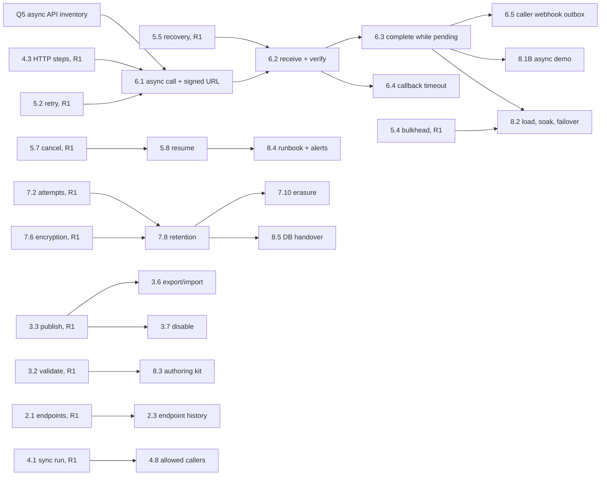
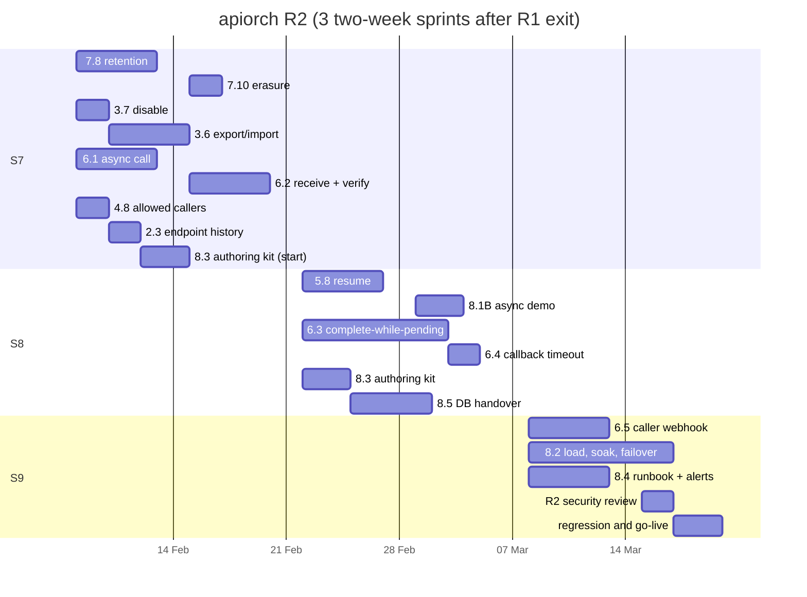

# apiorch — R2 Implementation Plan

**Release:** R2, the first customer release (README §3). **Source of truth:**
[user-stories/README.md](../user-stories/README.md). Story IDs, sizes and dependencies below come
from its §2 story map. Sprint numbering continues from
[R1-implementation-plan.md](R1-implementation-plan.md), which ended at S6 (R1 exit). Where this
plan overlaps work for speed, it says so explicitly.

> **Dates are illustrative.** Every calendar date in this plan (sprint calendar, gantt, review
> checkpoints) is for documentation only and does not drive execution. Work starts when it is
> picked up; sprint numbers give the order, not the timing.

---

## 1. Scope

R2 contains **17 items**: 16 stories and US-8.1 slice B.

| Epic | Stories (size) |
|---|---|
| E2 Endpoints | US-2.3 (S) |
| E3 Definitions | US-3.6 (M), US-3.7 (S) |
| E4 Run execution | US-4.8 (S) |
| E5 Resilience | US-5.8 (M) |
| E6 Async steps | US-6.1 (M), US-6.2 (M), US-6.3 (L), US-6.4 (S), US-6.5 (M) |
| E7 Logging & data protection | US-7.8 (M), US-7.10 (S) |
| E8 Enablement | US-8.1 **slice B** (the async demo, ≈ S), US-8.2 (L), US-8.3 (M), US-8.4 (M), US-8.5 (M) |

**Also in R2: the work R1 deliberately deferred into it.** These are not new stories; they are
acceptance criteria and tests of R1 stories that could only be finished once E6 existed
(R1 plan §6, "left for later sprints"):

| Carried item | Lands with |
|---|---|
| US-5.1 AC5 — post-completion segments | US-6.3 |
| US-5.4 AC4 — waiting runs are not counted as in-flight (true by construction, needs its test) | US-6.3 |
| US-5.7 AC3 — cancel of a waiting run, and the late callback after cancel | US-6.2 / US-6.3 |
| US-7.4 — callback entries in the timeline and callback detail | US-6.2 |
| US-7.7 AC4 — `COMPLETED_PENDING_ASYNC` in the caller response | US-6.3 |
| US-7.6 — outbox payload encryption | US-6.5 |
| US-7.5 AC6 — the meters of each R2 story | its own story |

**Not in R2:** US-3.5 (dry run), US-4.5 (conditions), US-5.6 (compensation), US-7.9 (tracing) and
US-6.6 (fixed callback endpoint) stay in R3. `FeatureRegistry` (US-3.2 AC7) keeps `CONDITIONS` and
`COMPENSATION` at `false`; `ASYNC_STEPS` flips to `true` only when US-6.1–US-6.4 are all merged.

**R2 exit criteria** (README §3), verified in §9 below:
- async steps with complete-while-pending;
- callback timeouts;
- caller webhooks;
- operator resume;
- retention and erasure;
- promotion between environments;
- the NFRs proven (US-8.2);
- the operations runbook;
- the production database handed to the DBA team (US-8.5).

## 2. Effort and assumptions

| Item | Value |
|---|---|
| Story effort (README sizes: S ≈ 2, M ≈ 4.5, L ≈ 8 dev-days midpoint) | **≈ 69 dev-days** |
| Carried R1 acceptance criteria and their tests (§1) | **≈ 5 dev-days** |
| Non-story work: production environment, go-live hardening, defects, the R2 security review, release mechanics | **≈ 12 dev-days** |
| **Total** | **≈ 86 dev-days** against a capacity of 84 (3 sprints × 28) |
| Team assumed | The R1 team: 4 backend developers, 1 QA/SDET (shared), part-time DevOps support. The DBA team joins at the move to production (US-8.5) |
| Cadence | 2-week sprints. Focus factor 0.7, so ≈ 7 productive dev-days per developer per sprint and **≈ 28 per sprint** for the team |
| Duration | **3 sprints (S7–S9) ≈ 6 weeks** |

**The plan has no slack.** Demand (≈ 86) sits just above capacity (84), and the trim list is the
three `Should` stories — US-2.3, US-3.6 and US-7.10 — which the Business Owner would have to
agree to drop. Pulling US-6.6 in (see the entry criterion) adds ≈ 4.5 dev-days and makes a fourth
sprint the honest answer.

## 3. R2 entry criteria

Unlike R1 there is no Sprint 0: the stack, the schema conventions, the test tiers and the
concurrency rules are all settled. What R2 does need before S7 starts:

| # | Entry criterion | Owner | Blocks | Status |
|---|---|---|---|---|
| E1 | **Q5 — the inventory of the real async APIs** (README §16): per API the callback style (per-request URL vs fixed registered URL), the signature scheme, the correlation field and the expected callback latency. This is the formal R2 entry criterion (README §3) | Business Owner | US-6.1 (all of E6) | R1 plan §12 asked for it from S3; confirm before S7 |
| E2 | **Q4 — the `200`-with-`FAILED` status contract** signed off by the calling-system teams. R1 was internal, so this had to be answered before R2 | Calling-system owners | US-4.2 contract, US-6.5 payloads | must be closed in S7 |
| E3 | **Q1 — retention periods and erasure scope** under the DPDP Act 2023 (24 h context, 7 days resumable context, 30 days payloads, 180 days runs) | Compliance / DPO | US-7.8, US-7.10 | defaults ship configurable; sign-off needed before go-live |
| E4 | **The E6 design note** (callback token and key rotation, the wake-up path, `callback_inbox` partitioning), reviewed against README §5.1 | Tech lead | US-6.1, US-6.2 | R1 plan §12 put the spike in S6; review at the start of S7 (§8) |
| E5 | **A three-node performance environment** with SQL Server 2022 and the WireMock downstream rig. There is no CI server, so this is a developer or shared host with Docker | DevOps + QA/SDET | US-8.2 | provision during S7 |
| E6 | **Production database request accepted by the DBA team**, from the US-8.5 pack. Handed over at the *start* of R2, not at go-live (R1 risk R9) | Tech lead + DBA | go-live | S8 |

If E1 is not in place, E6 cannot start and the whole release slips: nothing else in R2 is long
enough to fill a sprint in its place.

## 4. Dependency graph and critical path

**Hard and soft dependencies.** As in R1, "depends on" means *done before*, and this plan overlaps
the soft ones on purpose:

| Dependency | Kind | How the overlap works |
|---|---|---|
| US-6.3 → US-6.2 | Tight | The quiescence decision and the callback transaction share the run lock and the wake-up flag (README §5.1 rules 1 and 4). The two are built by the same developer, with a second on the ITs |
| US-6.4 → US-6.2 | Soft | `CallbackTimeoutSweeper` needs only `step_execution.callback_deadline_at` and the same lock order, so it is written against US-6.2's transaction helper while US-6.3 is in flight |
| US-6.5 → US-6.3 | Soft | The outbox table, dispatcher, HMAC signing and SSRF guard need only the R1 statuses. The `COMPLETED_PENDING_ASYNC` and re-completion events are added when US-6.3 merges |
| US-8.2 → US-6.3 | Hard | The Steady and Callback-storm scenarios both need async steps. No useful NFR proof exists before US-6.3 |
| US-8.4 → US-5.8 | Soft | The runbook is written per condition as each story lands; the resume entries wait for US-5.8 |
| US-8.5 → US-7.8 | Soft | The provisioning script and grants exist from R1 (US-7.1). Only the partition-maintenance section waits for US-7.8 |
| US-7.10 → US-7.8 | Soft | Erasure reuses the retention purge primitives; it is written straight after them, in the same track |

**Critical path: the callback track.** Q5 → US-6.1 (4.5) → US-6.2 (4.5) → US-6.3 (8) →
US-8.2 (8), for **≈ 25 dev-days**, which is 3.6 sprints for one developer at the 0.7 focus
factor — more than the release has. **Three sprints hold only if US-6.3 and US-8.2 are paired**,
exactly as R1 paired US-4.3 and US-5.5, bringing the path to ≈ 17 wall-clock dev-days. US-6.5
(4.5) hangs off US-6.3 and runs in parallel with US-8.2.

## 5. Workstreams

| Workstream | Developer | Stories | ≈ dev-days |
|---|---|---|---|
| **A: Data protection and go-live** | Dev A | 7.8, 7.10, 5.8, 8.1B, 6.5 | ≈ 18 |
| **B: Definitions, admin and enablement** | Dev B | 3.7, 3.6, 8.3, 6.4, pairing on 6.3 and 8.2 | ≈ 17 |
| **C: Callback engine** (critical path) | Dev C | 6.1, 6.2, 6.3, then 8.2 with B | ≈ 25 |
| **D: Security, operations and handover** | Dev D | 4.8, 2.3, 8.5, 8.4, the R2 security review | ≈ 18 |
| **QA/SDET** (shared) | — | The perf rig (E5), the callback-storm harness, the R2 end-to-end suite, slow-tier stabilization, exit verification (§9) | — |

## 6. Sprint plan

| Sprint | Dev A | Dev B | Dev C (critical path) | Dev D | Sprint goal / demo |
|---|---|---|---|---|---|
| **S7** | **US-7.8** (retention job, `PartitionMaintenanceJob`, legal hold) → **US-7.10** | **US-3.7** → **US-3.6** | **US-6.1** (callback token, `X-Callback-Url`, `ASYNC_ACCEPTED`, `AWAITING_CALLBACK`) → **US-6.2** (`V8__callback_inbox`, verification, classification) | **US-4.8** → **US-2.3** (`V10__endpoint_audit`) → start **US-8.3** | **M6 "Callbacks arrive":** an async step is called with a signed, per-execution URL, its callback is verified and recorded, retention and erasure run on a schedule, a pipeline can be disabled and promoted between environments |
| **S8** | **US-5.8** (resume, new segment, `exec_no + 1`) → **US-8.1 slice B** (async demo walkthrough) | Pair on **US-6.3**; **US-6.4** (`CallbackTimeoutSweeper`); carried US-7.4 callback detail and US-7.7 AC4 | **US-6.3** (quiescence, `WAITING_CALLBACK`, `COMPLETED_PENDING_ASYNC`, dependent resume, carried US-5.1 AC5 and US-5.4 AC4) | Finish **US-8.3** → **US-8.5** (provisioning and verify scripts, operations guide, handover) | **M7 "Async runs end to end":** a run completes while a non-blocking callback is outstanding, the late callback resumes its dependents in a new segment, a missing callback times out into its failure policy, an operator resumes a failed run |
| **S9** | **US-6.5** (outbox, HMAC signing, SSRF/DNS-rebinding guard, encrypted payloads) | **US-8.2** with Dev C (scenario harness, report) | **US-8.2** (three nodes, SQL Server, the six scenarios, `perf/REPORT.md`) | **US-8.4** (runbook, `promtool`-tested alert rules); R2 security review; regression and defects | **M8 = R2 exit:** the caller's webhook is delivered and redelivered after a restart, the NFRs are proven on three nodes with a report, every alert has a runbook entry, and the production database is in the DBA team's hands |

*The gantt is in working days (weekends excluded) and assumes S7 starts Monday 8 Feb 2027. Each
bar's length is its share of the sprint table above. The dates are illustrative only (see the note
at the top): shift the whole chart to wherever R2 actually starts.*

## 7. Cross-cutting enablers (early in S7, so the four tracks don't block each other)

1. **Migrations V8–V10 written up front**, straight from README §10: `V8__callback_inbox.sql`
   (partitioned by month on `received_at`), `V9__outbox_event.sql`, `V10__endpoint_audit.sql`.
   Every run and step column E6 needs already exists — `V4__run.sql` created
   `callback_deadline_at`, `callback_kid`, `completion_seq`, `resume_count` and
   `caller_webhook_url` in R1. Numbers follow delivery order; each stays expand/contract.
2. **One callback transaction helper.** Callback receipt (US-6.2), callback timeout (US-6.4),
   resume (US-5.8) and shutdown release all do the same thing: lock the run row then the step row
   with `SqlDialect`, write their event, set `wakeup_requested = 1`, commit, notify after commit
   (README §5.1 rules 1, 4 and 8). It is written once in S7 and reused, so the wake-up path has a
   single implementation to test.
3. **Four background jobs, one sizing decision.** `CallbackTimeoutSweeper` (US-6.4),
   `OutboxDispatcher` (US-6.5), the retention job and `PartitionMaintenanceJob` (US-7.8) join the
   recovery sweeper. All are ShedLock-guarded where they must be cluster-single, and all draw on
   the Hikari pool: set `maximum-pool-size` from README §14's capacity budget
   (`step-io.size + 16` as the starting point) before US-8.2 measures it.
4. **The perf rig as a product, not a script** (entry criterion E5): three apiorch nodes, SQL
   Server 2022, WireMock with realistic latency distributions, a callback generator that can
   produce 10 000 callbacks a minute with 5% duplicates and 1% invalid tokens, and the report
   generator for `perf/REPORT.md`. Built by the QA/SDET during S7–S8 so S9 is measurement, not
   plumbing.
5. **Feature gate flip.** `ASYNC_STEPS` stays `false` until US-6.1–US-6.4 are all merged, so no
   environment can publish an async pipeline it cannot finish. `CONDITIONS` and `COMPENSATION`
   stay `false` for R3.
6. **Test tiers unchanged** (README §13). The new race tests — `CallbackVsTimeoutRaceIT`,
   `CallbackQuiescenceRaceIT`, `LostWakeUpIT`, `OutboxReclaimIT`, `RetentionJobIT`,
   `PartitionDropIT` — carry the `slow` tag and run with `./mvnw verify -Pslow` before merge and
   before each sprint review.

## 8. Architecture review checkpoints

| When | Review | Entry condition |
|---|---|---|
| Start of S7 | **E6 design:** callback token format and key rotation (`token_kid`), per-execution URLs, `callback_inbox` partitioning, the wake-up path against README §5.1 | The E6 design note (entry criterion E4) and the Q5 inventory |
| Mid S8 | **Completion semantics:** the quiescence table (`WAITING_CALLBACK` vs `COMPLETED_PENDING_ASYNC`), lease release while waiting, segment restart on a late callback, and what the caller sees in each state | US-6.3 draft branch |
| Start of S9 | **Data protection:** retention periods against Q1, erasure scope, legal hold, partition truncation vs batched delete, and what stays after erasure | US-7.8 and US-7.10 merged |
| End of S9 | **R2 security review and go-live readiness:** the callback security chain and token verification, webhook SSRF and DNS-rebinding guards, outbox payload encryption, the production grants in the US-8.5 pack, and the open items carried from the R1 review | US-6.1, US-6.2, US-6.5, US-7.8, US-8.5 merged; [`R1-security-review.md`](R1-security-review.md) items closed |

## 9. R2 exit verification

| Exit criterion (README §3) | Evidence | Status |
|---|---|---|
| Async steps with complete-while-pending | `AsyncStepIT`, `AckFailedAfterCallbackIT`, `CallbackTokenServiceTest`, `FeatureGateAsyncTest` (US-6.1); `CompletePendingAsyncIT`, `WaitingCallbackIT`, `CallbackDuringRunningIT`, `LateCallbackNewSegmentIT`, `LostWakeUpIT` (US-6.3) | planned |
| Callbacks verified, exactly once, never lost | `CallbackReceiveIT`, `CallbackSecurityIT`, `CallbackDuplicateIT`, `CallbackLateIT`, `CallbackErrorsIT`, `EarlyCallbackIT`, `CallbackQuiescenceRaceIT` (US-6.2) | planned |
| Callback timeouts | `CallbackTimeoutIT`, `CallbackTimeoutBatchIT`, `CallbackVsTimeoutRaceIT` (US-6.4) | planned |
| Caller webhooks | `CallerWebhookIT`, `RedeliverIT`, `OutboxCrashIT`, `OutboxReclaimIT`, `OutboxSlowReceiverIT`, `OutboxDeadBlocksStreamIT`, `DnsRebindingIT`, `CallerWebhookUrlValidationTest`, `WebhookEventMatrixTest` (US-6.5) | planned |
| Operator resume | `ResumeIT`, `ResumeResourceIT`, `ResumeUnresolvedIT`, `ResumeContextPurgedIT`, `ResumeAsyncTokenIT`, `ResumeIllegalStateIT` (US-5.8) | planned |
| Retention and erasure | `RetentionJobIT`, `RetentionShedLockIT`, `PartitionMaintenanceIT`, `PartitionDropIT`, `LegalHoldRetentionIT` (US-7.8); `ErasureIT` (US-7.10) | planned |
| Promotion between environments, and the kill switch | `ExportImportIT` (US-3.6); `PipelineDisableIT` (US-3.7) | planned |
| Caller restrictions and endpoint history | `AllowedCallersIT` (US-4.8); `EndpointAuditIT`, `EndpointHistoryApiIT` (US-2.3) | planned |
| NFRs proven | `perf/REPORT.md` from US-8.2: Steady, Soak, Spike, Node failover, Downstream outage, Callback storm, each against its pass criteria; README §14 storage figures replaced by the measured bytes per attempt and per run | planned |
| Operations runbook and alerts | `docs/runbook.md`, `ops/alerts/apiorch-rules.yml` with `PromtoolRulesIT`, `RunbookCoverageTest`, `RunbookExamplesIT` (US-8.4) | planned |
| Authoring kit | `docs/schema/pipeline-v1.schema.json`, `docs/authoring-guide.md`, `docs/caller-guide.md`, with `SchemaDriftTest`, `RecipeFixturesTest`, `AdminCollectionIT` (US-8.3) | planned |
| Production database handed over | `ops/db/provision-apiorch.sql` and the verify script with `ProvisioningScriptIT`, `VerifyScriptIT`, `HandoverSecretsScanTest`; the pack accepted by the DBA team (US-8.5) | planned |
| Async demo | US-8.1 slice B: the api4 async step published as a new version over slice A's pipeline, run through `demo/walkthrough.ps1` and `DemoWalkthroughIT` | planned |
| R2 security review | `docs/R2-security-review.md` (to be written, same shape as R1's) | planned |

**Also at R2 exit, but not exit gates:** the first and last `RANGE RIGHT` partitions are still
empty in every environment (README §10), and the partition-boundary alert from US-8.4 has been
seen to fire at least once on a deliberately broken environment.

## 10. Risks and mitigations

| # | Risk | Likelihood / impact | Mitigation | Trigger to act |
|---|---|---|---|---|
| R10 | **The Q5 async-API inventory is late** (entry criterion E1). E6 is 23.5 of the 69 story dev-days and the whole critical path | Medium / High | Chase it from S6 of R1 (R1 plan §12). If it is still missing at S7 planning, build US-6.1/6.2 against the two callback styles the DSL already allows and treat real-API fit as a defect class; do not start US-6.3 blind | S7 planning with no inventory |
| R11 | **An async API needs a fixed callback URL**, pulling US-6.6 (Could, M) from R3 into R2 | Medium / Medium | README §3 already names this. It adds ≈ 4.5 dev-days and a correlation-field design; trade it against the three `Should` stories (§2) with the Business Owner | The Q5 inventory shows a fixed-URL API |
| R12 | **Capacity is ≈ 86 against 84** (§2), so any growth lands on the release, not on a buffer | Medium / High | Trim list agreed up front: US-2.3, US-3.6, US-7.10. Pair on US-6.3 and US-8.2 as planned; re-estimate at S7 planning | Velocity below 26 dev-days in S7 |
| R13 | **Concurrency defects in the callback and wake-up path** — a lost wake-up, a callback racing the timeout sweeper, a late callback after cancel | Medium / High | The single callback transaction helper (§7 item 2), the S8 completion-semantics review, and the race ITs on the `slow` tier before every merge | Any flaky callback or quiescence test |
| R14 | **US-8.2 finds an NFR miss late**, in the last sprint, with no room to fix it | Medium / High | Build the rig in S7–S8, not S9, and run the Steady scenario as soon as US-6.3 merges rather than waiting for the full suite. US-8.2 AC2 already allows a miss to be a recorded defect with an owner, but only one found early can be fixed | Steady scenario missing its p95 at the first run |
| R15 | **Measured storage exceeds the ≈ 170 GB/day planning figure** (README §14), so production sizing changes after the hardware is ordered | Medium / Medium | US-8.2 AC4 measures bytes per attempt first, in S9's opening days, and `METADATA` remains the default capture level (US-7.3) | The first Steady run's bytes per attempt above 4 KB |
| R16 | **The DBA team cannot provision production in time** (R1 risk R9, carried) | Medium / High | Hand over the US-8.5 pack in S8, not at go-live; the provisioning and verify scripts are tested in the build, so the DBA team runs them rather than interpreting them | S8 ends with no DBA acknowledgement |
| R17 | **Q1 retention sign-off arrives after the code** | Medium / Low | Every period is a configuration key with a documented default; US-7.8's tests drive the periods from configuration, so a change is a value change, not a code change | Go-live planning with Q1 open |
| R18 | **Boot 3.5 is out of OSS support** (R1 risk R1, carried) and R2 is the first *production* release, so the decision can no longer be deferred | Medium / High | Close the commercial-support-vs-Boot-4 decision before go-live, as ADR-003 and the S0 decision require. Re-run `tools/stack-probe-b35-mssql` on any version bump | R2 go-live date set |

**Open questions after R2:** Q2 (Aadhaar), Q3 (non-JSON bodies), Q6 (hash chain over `run_event`)
and Q7 (an audited unmasked-read endpoint) remain open and belong to R3 or to a compliance
follow-up. None of them blocks R2 exit.

## 11. Scaling with team size

| Developers | Capacity per sprint | Sprints | Notes |
|---|---|---|---|
| 3 | ≈ 21 dev-days | **4–5** | Merge workstreams A and D. The callback path still needs two developers, so the enablement stories (8.3, 8.4) slide to the end |
| **4 (this plan)** | ≈ 28 | **3** | As laid out in §6, with no slack and pairing on US-6.3 and US-8.2 |
| 5 | ≈ 35 | **3** | The extra developer goes on the perf rig and the callback-storm harness from day 1, which de-risks R14 more than extra story capacity would |

## 12. R3 preparation to start during R2, off the critical path

- **US-5.6 compensation** is the largest R3 story and depends on US-6.1's `completion_seq`, which
  lands in S7. Sketch the compensation order and the `COMPENSATING` transitions while E6 is fresh.
- **Q7** (an operator endpoint for unmasked reads with dual approval) needs Security and
  Compliance. Raise it with the evidence the R2 runbook produces.
- **US-7.9 tracing** needs a collector in the environments; ask DevOps for it during the S9
  go-live work rather than at R3 planning.
